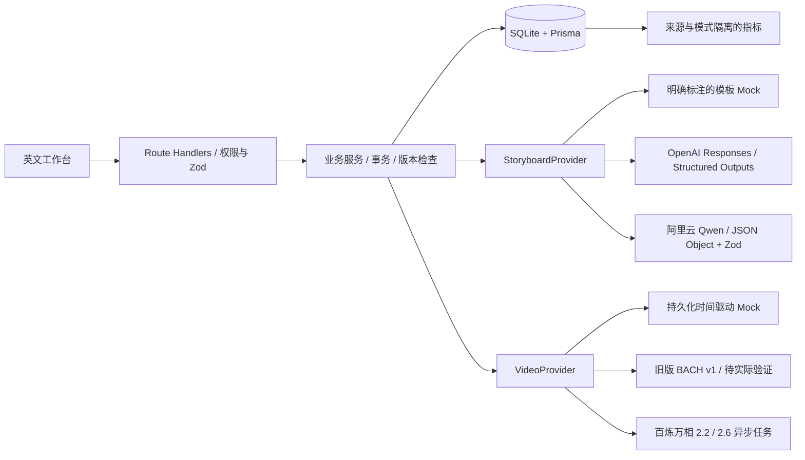

# 技术架构

## 系统与数据流

Next.js App Router + React/TypeScript/Tailwind。浏览器使用同源 REST API，Route Handlers 调用业务服务，服务通过 Prisma 访问单个 SQLite 文件。Node.js 单实例，不依赖队列服务或外部分析平台。UI 的 Frame 是产品展示名，项目名为 AI Video Creative Studio。

## 数据模型

- Project：Brief JSON、Creative Direction JSON（字段仍名 profile）、profileVersion、revision、origin、storyboardMode、生成及修改时间。
- Scene：Project 外键、顺序、selectedGenerationTaskId 和经 Zod 校验的结构化分镜内容。编辑保持已有 ID；删除时任务 sceneId 设为 null。
- GenerationTask：Provider/Mode、状态、远端 ID、输入快照、时间、结果 URL / localMediaPath、错误、重试关联和唯一 idempotencyKey。
- ProjectOutput：状态、选片快照、selectionKey 哈希、模式、媒体路径、实际时长与错误；同项目同快照唯一。
- Review：每个任务至多一份最新评分和反馈；更新不增加样本数。
- Event：事件名、时间、Session ID、Project ID、origin、mode、properties、唯一去重键。

SQLite 文件被忽略，不提交到 Git。迁移脚本先确保文件和父目录存在，再运行 Prisma migrate deploy；已有文件不截断。测试使用临时数据库或独立 e2e.db。

项目整体删除使用现有外键 Cascade，在事务中检查 revision、Pending/Processing 任务，再按相同条件执行删除，清理 Scene、GenerationTask、Review、Event、ProjectOutput 及该项目的本地媒体目录；构建中的输出也阻止删除。单独删除 Scene 仍为 SetNull，不删除历史尝试。项目删除不请求外部服务取消任务或删除远端媒体；项目事件删除后 Analytics 不再统计该项目。确认框展示关联数量、不可恢复说明和费用边界，可只同步活动任务状态后再删除。

## 公共接口

接口返回 `{ data }` 或 `{ error: { code, message } }`。业务 API 不缓存响应。Zod 错误返回 422，版本冲突 409，不存在 404，未登录 401，跨域变更 403。

| 接口                                              | 用途                                                                 |
| ------------------------------------------------- | -------------------------------------------------------------------- |
| GET/POST /api/projects                            | 列表 / 创建 Brief                                                    |
| GET/PATCH /api/projects/:id                       | 项目恢复 / 修改 Brief、名称、Profile                                 |
| DELETE /api/projects/:id                          | JSON 请求体传 revision；永久删除项目及关联记录，活动任务返回 409     |
| POST/PUT /api/projects/:id/storyboard             | 生成 / 保存完整有序分镜草稿                                          |
| POST /api/projects/:id/scenes/:sceneId/regenerate | 重写单镜头，保持时长                                                 |
| POST /api/projects/:id/tasks                      | 提交选定镜头；revision、sceneIds、UUID idempotencyKey、Mock scenario |
| GET /api/tasks                                    | 任务及最新 Review                                                    |
| POST /api/tasks/:id/sync                          | 查询 Provider 并持久化状态                                           |
| POST /api/tasks/:id/retry                         | 新尝试，关联原任务；不覆盖历史                                       |
| PUT /api/tasks/:id/review                         | 1–5 分及反馈                                                         |
| POST /api/projects/:id/export                     | 导出并记录事件                                                       |
| GET /api/analytics                                | mode、origin、from、to 筛选                                          |
| POST /api/auth                                    | 登录或退出                                                           |
| GET /api/health                                   | 数据库连通性，不暴露项目内容                                         |

## LLM 与共享说明

StoryboardProvider 暴露 generate / regenerateScene。默认 Mock 根据 Brief 产生模板，15 秒三镜头，30 秒五镜头。Live 使用 OpenAI Responses 的 strict JSON Schema，模型由 OPENAI_MODEL 设置，服务端进行 Zod 及镜头数/总时长校验。JSON 或业务约束无效最多重新请求一次；拒绝、截断、网络错误和限流不自动重复。失败保留旧分镜。

低成本替代通过 `STORYBOARD_PROVIDER=qwen` 选择：直接使用阿里云兼容 Chat Completions 接口，无需 OpenAI 账号。`DASHSCOPE_API_KEY`、`DASHSCOPE_BASE_URL` 只在服务端读取，Base URL 由用户从对应业务空间/地域控制台复制；仅接受官方 HTTPS 地址且禁止重定向。默认 `qwen-flash`，`enable_thinking=false`、`response_format=json_object`、最多 8,192 输出 Token；系统 Prompt 包含 JSON 关键字及目标 Schema。JSON Object 不保证结构，服务端仍执行相同的 Zod/业务校验，至多修复一次。拒绝、截断、无内容、无效响应外壳、HTTP 错误、超时不自动重试，不转发原始提供方错误或密钥。Qwen 的分镜/事件模式归为 live，视频 Provider 独立配置。真实付费接通情况见 TEST_RESULTS.md。

Profile 的四个字段是共享文本说明。最终 Prompt = 镜头 Prompt + 当前 Profile + 镜头一致性备注。编辑 Profile 不重写镜头 Prompt；生成任务保存 Profile 版本与最终 Prompt 快照。它不是身份锁定、图像参考或一致性质量保证。

## 视频 Provider 与状态

万相 3.0 通过 `VIDEO_PROVIDER=wan3.0` 固定为 `wan3.0-video` / 480P / 2–30 秒 / Prompt 20,000 字符。只实现纯文生视频，提交 `input.prompt`，使用 `resolution=480P`、`ratio`、固定镜头 `duration`、`audio=true`、`watermark=false`、`prompt_extend=false`，不混用旧版 `size` 参数。本次按官方文档只允许业务空间专属域名，未配置时在提交前报错。异步状态及结果查询复用下述逻辑；历史任务仍按保存的 Provider 查询与重试，不随当前配置换模型。`DASHSCOPE_MODEL=qwen3.8-flash` 复用现有非思考 JSON Object Adapter，并保留旧 Qwen 型号的显式配置。[万相 3.0 协议](https://help.aliyun.com/zh/model-studio/wan3-video-generation-api-reference)、[Qwen JSON 输出](https://help.aliyun.com/zh/model-studio/qwen-structured-output)

真实万相通过 `wan2.2` / `wan2.6` 固定模型与分辨率，避免修改默认配置后把历史重试改成另一收费规格。前者为 wan2.2-t2v-plus / 480P / 5 秒 / Prompt 800 字符，后者为 wan2.6-t2v / 720P / 2–15 秒 / Prompt 1,500 字符。同一百炼 Key 和 Base URL 复用；提交请求使用 Bearer、X-DashScope-Async=enable 和 `/api/v1/services/aigc/video-generation/video-synthesis`，查询 `/api/v1/tasks/:id`，约 15 秒轮询。Prompt 扩写关闭，始终传入保存的最终 Prompt；Qwen 根据共享档案占用和视频能力预留字数，用户输入不截断。

万相 Pending/Running 映射为 pending/processing，Succeeded 为 completed，Failed/Canceled/Unknown 为 failed。HTTP 5xx/408、网络失败或无可确认任务 ID 的提交响应标为 SUBMISSION_UNKNOWN，不重发；查询错误保留原任务。时间采用本地观察到开始/终态的时刻，耗时包含轮询延迟，不假装具有服务商精确计时。返回的 HTTPS 视频 URL 约 24 小时有效，预览或合并时流式缓存到 MEDIA_ROOT；首次缓存之前 URL 过期仍会失败。配置接口仅返回缺失环境变量的名称，缺少配置时工作台明确提示且禁用生成。

VideoProvider 暴露 capabilities / submit / getStatus。提交前检查时长、整数要求、比例和组合 Prompt 长度。Mock 和旧版 BACH v1 以 1–8 秒为范围；不静默裁切。

Mock：0–1.5 秒 Pending，1.5–6 秒 Processing，6 秒后按保存的 scenario 成功或失败。终态时间来自预定时间而非最后一次查询时间。固定演示视频带水印，时长不等于规划时长。每次重试是新任务，Mock 重试默认成功。

BACH Live：只实现旧版 `/videos/text2video` 和对应查询路径，不混用当前 Pro 的 `/video/v2`。鉴权依据官方 AK/SK → HS256 JWT → Bearer，服务端签名。提交超时/不明响应不自动重发；重试前提示可能重复计费。所有 Provider 没有已确认 ID 的中断提交在 60 秒后转为状态不明的失败记录。查询错误保留任务，状态不从 Processing 回退 Pending。

打开工作台或 Tasks 时轮询；关闭页面不进行本地后台查询，重新打开后补查。真实 Provider 的远端生成独立执行。Analytics 的未同步终态可能暂时仍显示处理中；页面明确说明这一限制。

官方资料核实：2026-10-17。旧版 v1 页面已跳转，当前平台是 Pro；旧版可用性未做实际调用验证。[鉴权](https://www.bach.art/api/docs/authentication)、[当前接口](https://www.bach.art/api/docs/create_task)。

## Event Tracking 与指标

业务写入与事件写入同事务，终态事件用任务 ID 去重。必需事件：brief_created、storyboard_generated、scene_edited、generation_started、generation_completed、generation_failed、generation_retried、result_rated、project_exported；另记录 consistency_profile_updated。不保存密钥、完整 Brief 或完整 Prompt 到事件 properties。

mode 分 mock/live，Brief 事件为 neutral；origin 分 user/demo，测试数据库独立。Conversion 的模式指分镜 Provider，生成指标的模式指视频 Provider。所有分母及样本量在 UI 显示：

- Conversion：范围内创建、截至结束曾有对应模式 storyboard_generated 的项目 / 范围内创建 Brief 的项目。
- Success：范围内创建且截至结束已 Completed / 同批截至结束的 Completed + Failed。
- Rating：同批已完成任务最新评分平均值。最新评分在结束日期后更新的，不回溯重建旧评分。
- Failure：Failed / 终态；Retry：重试尝试 / 全部尝试；Duration：已完成尝试平均 completedAt − createdAt，包括排队。
- Pending/Processing 单列，不计入成功率。无样本为 null，显示 —。没有预填增长数据。

## 安全与错误处理

开发模式无密码时仅监听 127.0.0.1。生产模式默认拒绝未认证访问，即使未配置密码也不开放工作台。APP_PASSWORD 至少 12 字符，SESSION_SECRET 至少 32 字符；登录签发 8 小时 HttpOnly / SameSite=Lax Cookie，生产加 Secure。Proxy 和业务 API 都检查权限；变更操作校验 Origin/Host。简单单进程登录限额：10 次失败后等待 10 分钟。

密钥不会出现在配置响应或客户端代码中；外部错误不直接转发原始响应。真实视频缓存与输出位于本地目录，不是云媒体托管；未缓存的过期链接会报错。单人密码保护不是多人账号系统，退出清除浏览器 Cookie，不提供企业级全局会话撤销。

## 部署

Docker 使用 Next.js standalone 和生产依赖，运行迁移后启动。Railway 单实例挂载 /data；不把 SQLite 放在临时文件系统。实际部署验证状态见 TEST_RESULTS.md。

## P0 选片与 First Cut

- `PUT /api/projects/:id/scenes/:sceneId/select`：revision、taskId；验证项目/镜头归属、成功状态和有效结果链接，事务保存选择并递增版本。
- `POST /api/projects/:id/first-cut`：revision；要求每个 Scene 有成功选片。按顺序保存 Scene/Task/标题/规划时长/目标时长/画幅快照，对快照做 SHA256。相同快照复用已完成文件，处理中返回已有输出，失败或文件缺失允许重建。
- `POST /api/projects/:id/duplicate`：只复制 Brief、Creative Direction 与分镜，创建 user 来源项目，不复制视频/选择。
- `GET/HEAD /api/media/tasks/:id`、`/api/media/outputs/:id`：受现有权限保护，支持 Range、HEAD 和 `?download=1`。只按数据库映射解析受限媒体根目录路径，不接受任意客户端文件路径。

首次完成任务在同事务里仅对 selectedGenerationTaskId=null 的 Scene 设置选择，后续成功保留选择。UI 状态由有效选片、活动任务、匹配输出推导，不另存 projectStatus。编辑 Prompt/Creative Direction 不篡改历史生成或选片；选择、顺序、画幅、目标/镜头规划时长或标题变化时输出签名变化，界面提示重建。历史输出快照不覆盖。

合并先缓存已选片段，再用 ffprobe 获取实际视频时长，统一画布、30fps、H.264/yuv420p、AAC/stereo/48kHz；缺音轨时填静音，有音轨时保留并按视频时长补齐。随后 concat copy 输出，文件临时写入后重命名。视频没有按规划秒数裁切或补帧，界面展示实际值。输出音频仅硬切，无新增音频编辑功能。处理错误保留选片；超过15分钟的遗留 processing 构建在读取项目时转为 failed，可重建。

缓存目录默认 `.local-media`，被 Git 和 Docker build context 忽略；生产挂载 `/data/media`。需要 FFmpeg/ffprobe。初剪失败和过期源给出可操作错误，不自动调用模型替换。`public/examples/morning-brew` 是真实生成的稳定示例素材与无凭证清单；`seed-example.mjs` 幂等导入并且不发网络请求。本地初次安装显式执行 `npm run db:seed-example`，容器可执行 `node scripts/seed-example.mjs`；普通重启不恢复已删除 Example。

媒体与 SQLite 需一起备份。单实例本地实现没有持久后台队列；页面关闭后当前服务请求可能完成，服务终止则构建转为可重试失败。未添加 MP4 下载埋点；已有 project_exported 指 JSON 导出，不可冒充 First Cut 完成率。
