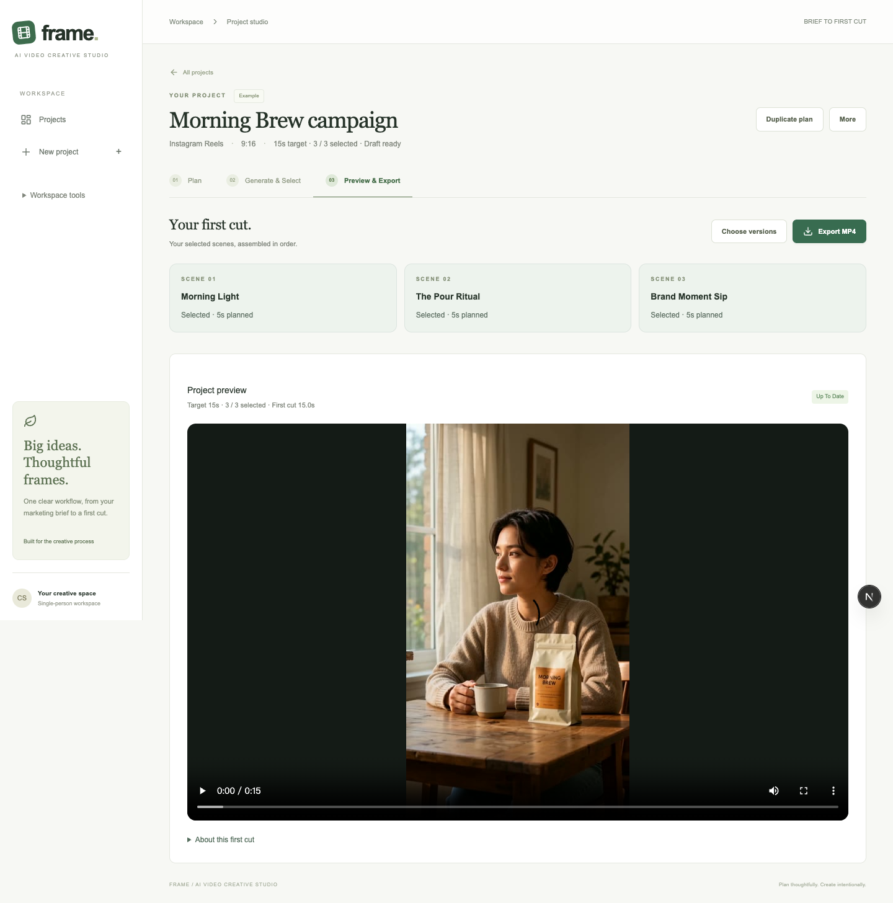

# Frame — From a Marketing Brief to a Reviewable First Cut

## Problem and hypothesis

A marketing brief describes an audience and an objective; video models require concrete shot instructions. I explored whether a project workspace could help turn a brief into a reviewable draft and make weak shots easier to iterate. Demand, usability and time savings have not yet been validated with external users.

**Proposed job to be done:** When I have a short-form marketing brief, I want to turn it into a first-cut video so I can evaluate the overall concept and selectively iterate weak shots without regenerating the whole project.

## Discovery and product decisions

Lightweight official-source research covered BACH, Runway and Adobe Firefly. Runway already offers workflows and references, and Firefly offers shot/reference controls. I did not frame these capabilities as missing from competitors. Frame's hypothesis is about marketing workflow organization and traceable creative choices, not superior generation quality or a technical moat.

During internal use, the builder found that Storyboard and Visual Consistency felt repetitive, while independent generation tasks did not add up to a project result. This feedback was not a user interview. I changed the completion unit from a successful task to a selected scene version, then an assembled first cut.

## Scope and workflow

**Projects → Plan → Generate & Select → Preview & Export.**

Plan brings the brief, editable storyboard and four-field Creative Direction together. Shared instructions are prompt guidance for future generations; they do not guarantee cross-shot identity. Generate & Select centers each scene's chosen version, with attempts, retries and optional private Review Notes in details. The first success is selected automatically; later results never overwrite an existing choice.

Scenes use five structured shot fields by default. A deterministic composer maps edits into the exact submitted prompt; an explicit advanced override preserves manual control. One Save Plan action commits the brief, shared direction and scenes atomically, with visible unsaved regions and retained drafts after failed saves. New projects use category-neutral defaults rather than inherited coffee-ad assumptions. These corrections came from internal review, not external user research.

Once all scenes have a selection, local FFmpeg assembles them in storyboard order into one downloadable MP4. Each output stores its selection snapshot; changed order or choices require a rebuild. Renaming the project or editing future-generation text leaves the existing cut current. Its canvas follows the first selected clip’s original aspect ratio. Watch and Export MP4 are the completed project’s primary actions. Target and actual durations are shown separately. This is a first cut with hard cuts and original clip sound, without timeline editing, transitions, captions, voice-over or music mixing.

## Implementation

Next.js, React, TypeScript, Tailwind CSS, Prisma, SQLite and Zod. Provider adapters separate storyboard creation from asynchronous video generation. Revision checks, idempotency keys, immutable prompt snapshots, persistent retry history and local media caching make the workflow recoverable. Mock providers remain development infrastructure; execution mode and Example provenance are separate internal dimensions. Activity and product analytics are secondary tools. Local first_cut_built and mp4_exported events distinguish assembly and download-response requests from JSON export; repeated byte-range requests share a deduplication key. A response is not proof that a user finished downloading the file.

The runnable Example contains a Qwen 3.8 Flash storyboard and three real five-second Wan 3.0 / 480P clips, plus a saved approximately 15-second first cut. Opening it makes no model requests. One clip already existed; two further clips were generated under the user's explicit maximum of two clips and ¥3 original-price estimate. Billing was not independently audited. Other provider implementations retain simulated contract coverage rather than claimed live verification.

## Evaluation and limits

Automated coverage includes parsing, persistence, task progression, failure/retry, capability limits, selection ownership, preservation of existing choices, stale output detection, actual FFmpeg assembly, byte-range media responses, playback and MP4 download. Exact executed results are recorded in TEST_RESULTS.md; protocol simulations are distinguished from real calls.

The real Example proves that this specific three-shot path can be assembled and reviewed. It does not establish representative model quality, character consistency, market demand or deployment readiness. SQLite and media must be backed up together; uncached provider links may expire. Original shot audio may change abruptly across cuts.

## Next validation

P0 closes the brief-to-first-cut task. Before adding more AI features, observe target users planning a non-coffee project, understanding save state and Creative Direction, choosing versions, building a cut and exporting the MP4. Measure task completion and collect confusion points. No external study results, growth or time-saving percentages are claimed.

## CV-ready descriptions

- Built a local-first brief-to-first-cut AI video workspace with Next.js, TypeScript, Prisma and SQLite, connecting editable plans, scene-version selection and MP4 export.
- Translated internal usability feedback into a three-stage project workflow, merging duplicate planning steps and introducing explicit creative selection with immutable output snapshots.
- Verified a Qwen 3.8 Flash → three Wan 3.0 clips → local FFmpeg first-cut workflow, alongside automated persistence, retry, provider-contract and browser tests.
- Designed prompt guidance, provider capability validation, idempotent submissions and recoverable media handling while documenting model limitations and unvalidated product hypotheses.

Developed with Codex assistance. No public deployment, external user research, revenue, guaranteed consistency or representative quality benchmark is implied.
