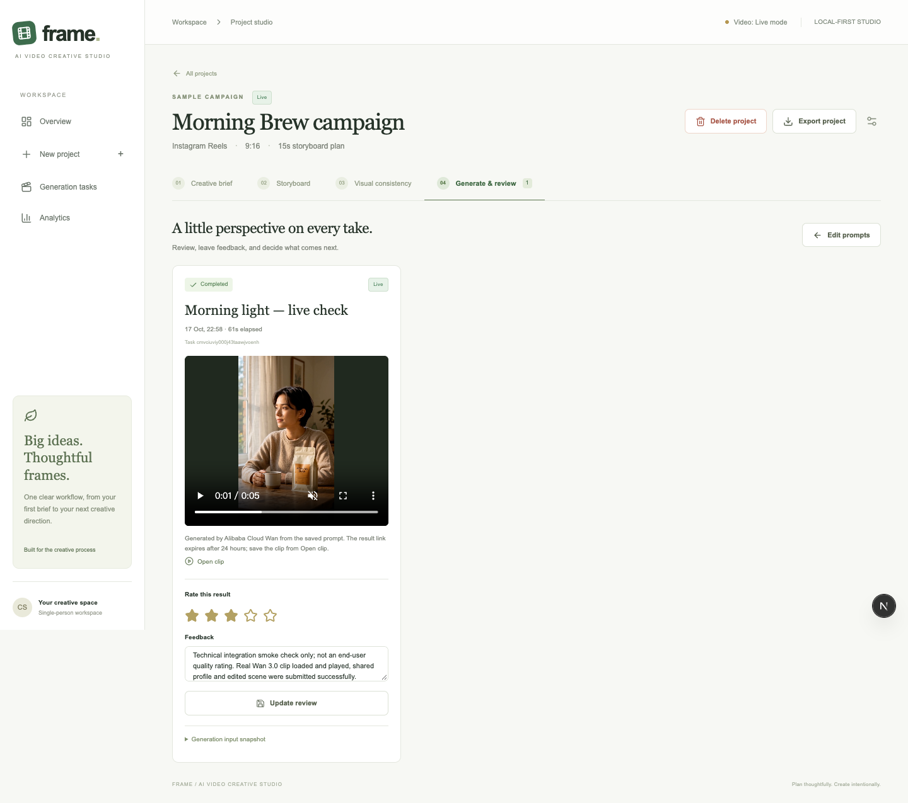

# AI Video Creative Studio — Frame

## Problem

Marketing briefs describe an audience and an objective, while video generation requires concrete scene and camera instructions. I explored the hypothesis that a structured workspace could help organize this translation and make iterations easier to trace. I have not validated demand through user interviews.

## Product Vision

Help a marketer move from a brief to an editable storyboard, shared visual instructions, individual clip-generation attempts, and review feedback in one local-first application.

## Target Users

Marketing specialists, social content creators, small-brand owners, and agency team members who need a focused planning workflow. This is a chosen initial audience, not a validated customer segment.

## My Role

Product framing, MVP prioritization, interaction design, and full-stack implementation with Codex-assisted development. I defined the data model, provider boundaries, event definitions, and an executable usability-testing plan. Automated tests are distinct from research with external participants.

## MVP Scope

A working Next.js application with persisted briefs, editable scenes, a four-field Visual Consistency Profile, asynchronous Mock video tasks, retry history, ratings, feedback, JSON export, and a small analytics dashboard. Default storyboards use labeled templates; default videos are fixed, watermarked demonstration assets. The application does not assemble a finished advertisement.

## Product Decisions

I prioritized the complete no-key workflow before real API adapters and analytics. Runway already offers references and workflows, and Firefly offers camera and reference controls; my differentiation hypothesis concerns a marketing-oriented planning and review experience, not a claim that competitors lack those capabilities. Shared visual instructions are prompt constraints, not a technical guarantee of cross-scene consistency.

## Technical Implementation

Next.js, React, TypeScript, Tailwind CSS, Prisma, SQLite, and Zod. Provider interfaces separate storyboard creation from video generation. Tasks preserve the final prompt and profile version, while revision checks protect newer edits. Mock task progression is derived from database timestamps so refreshes and process restarts do not erase its state. Live adapters target Alibaba Cloud Qwen and Wan 2.2/2.6/3.0, OpenAI Structured Outputs, and the historical BACH v1 text-to-video contract. One real workflow was verified with Qwen 3.8 Flash and a single five-second Wan 3.0 clip; the other adapters have protocol tests, not verified account access. Qwen was added in response to the builder's payment-access and cost constraints, with JSON output revalidated on the server; this does not establish comparative model quality.

## Challenges

I addressed invalid structured output, duration budgeting, duplicate submissions, ambiguous provider timeouts, retry history, and analytics denominators. Browser testing exposed an Origin/Host mismatch in the local server path, which was corrected. BACH's old documentation now redirects to a different Pro protocol, so I kept the legacy adapter separate and documented the availability uncertainty.

## Evaluation

The core success and failure/retry browser workflows were run successfully before adding live adapters. The latest unit/contract suite passed 65 tests, covering parsing, persistence, state progression, provider contracts, access protection, and analytics. Five original browser scenarios and a separate extension-hydration regression passed; the Wan configuration scenario was rerun after adding 3.0 support. Exact command results and the separate production restart checks are recorded in TEST_RESULTS.md.

A separate real API smoke run generated three storyboard scenes with Qwen 3.8 Flash, saved shared instructions and a scene edit, submitted one five-second Wan 3.0 / 480P clip, observed completion, verified playback in Chrome, saved a technical review, and exported the project. The initial structured-output failure led to more specific validation feedback for the one allowed repair request. This run used a Sample project; its review is labeled as a technical check, not end-user research. Account quota and charges were not independently audited. Other protocol tests remain simulated. One successful clip does not establish representative quality, cross-scene consistency, deployment readiness, or business impact. No external user-study findings are claimed.

## Future Improvements

Conduct observed task testing with target users; measure whether shared instructions are understood and useful; then evaluate reference-image support, additional providers, and clip assembly. Evaluate more real samples and failure cases, and separately verify legacy API availability. Deploy the password-protected application with persistent storage and test recovery.

## CV-ready descriptions

- Built a local-first AI video creative workspace with Next.js, TypeScript, Prisma, and SQLite, connecting marketing briefs, editable storyboards, shared visual instructions, and review feedback.
- Designed provider adapters with schema validation, capability checks, immutable generation snapshots, and persistent asynchronous task and retry history.
- Verified a real Qwen 3.8 Flash → Wan 3.0 workflow through five-second clip generation, browser playback, review persistence, and JSON export, alongside simulated contract coverage.
- Defined source-separated product metrics and implemented terminal-task success rates, brief-to-storyboard conversion, and latest-result ratings without pooling Mock and Live data.
- Used Codex-assisted development to translate product hypotheses into a working MVP, automated workflow tests, documented decisions, and an executable usability-testing plan.

No user growth, revenue, time savings, public deployment, guaranteed consistency, or representative model-quality benchmark is implied.
