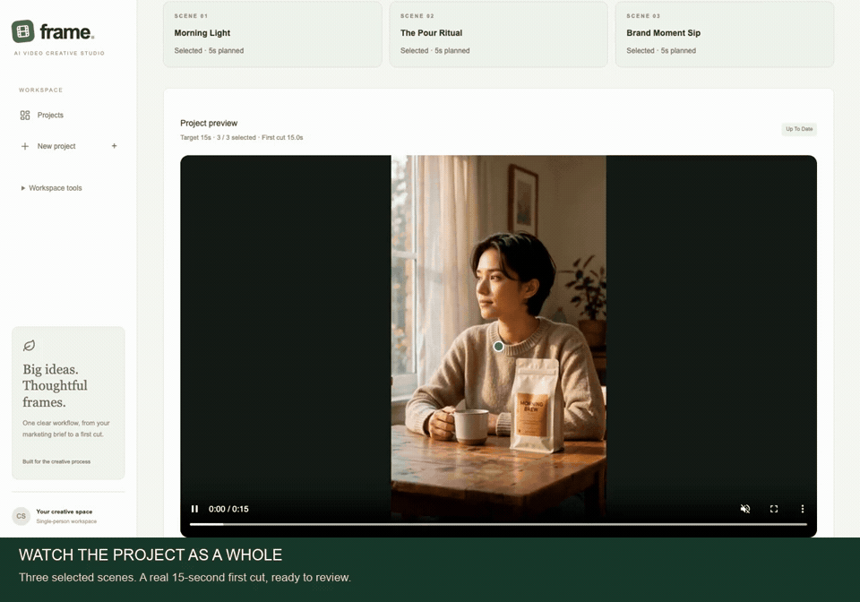

# Frame · AI Video Creative Studio

**Turn a marketing brief into a reviewable video draft.**

**Brief → Plan → Generate & Select → Preview & Export**

## See it in action

[](docs/demo/frame-demo.mp4)

**[Full demo · 67 seconds · MP4](docs/demo/frame-demo.mp4)** · [Product case study](PORTFOLIO_CASE_STUDY.md) · [Product decisions](PRODUCT_DECISIONS.md)

Recorded in the working app with three previously generated Qwen / Wan clips. Editing, selection, assembly and export are real operations; this walkthrough makes no model calls.

## What you can do

- **Plan:** edit the brief, five structured scene fields and shared Creative Direction; save them together. Preview the exact generation prompt or use an explicit advanced override.
- **Generate & select:** create individual clips, compare attempts and choose one version per scene. New results preserve the current selection.
- **Preview & export:** assemble selected clips into one MP4. Replace a clip or change the order to update the first cut; editing the plan leaves existing videos intact.

The bundled Example contains three real Wan clips and a saved ~15-second first cut. Open it without API keys or model calls. New projects default to clearly identified template / test providers; live Qwen + Wan adapters are available.

## Run locally

Requires **Node.js 22.20+** and npm. Install **FFmpeg + ffprobe** to build new cuts (`brew install ffmpeg` on macOS). Playing the bundled Example needs neither an account nor FFmpeg.

```bash
git clone https://github.com/TTTracieee/ai-video-creative-studio.git
cd ai-video-creative-studio
npm ci
cp .env.example .env
npm run db:migrate
npm run db:seed-example
npm run dev
```

Open **[localhost:3000](http://127.0.0.1:3000)** → **Morning Brew / Example**. Keep your existing `.env` if already configured. Project data stays in SQLite; back up the database and media directory together.

**Live models:** [Qwen + Wan setup and costs](REAL_API_SETUP.md). **Other configuration / deployment:** [setup reference](docs/SETUP.md).

## Built and verified

**Next.js · TypeScript · Tailwind CSS · Prisma · SQLite · Zod · Provider adapters · FFmpeg**

Revision checks, immutable generation snapshots, recoverable task history, local media caching and password protection support the workflow. At the latest product iteration, **77 automated tests and 9 browser scenarios passed**, alongside type checks, lint, production build and recovery checks. [Executed tests and limits →](TEST_RESULTS.md)

First Cut joins clips with hard cuts and original sound; it is not a full video editor. Shared direction is prompt guidance, not a cross-scene consistency guarantee.

## Product thinking

| Read                                               | Focus                                                    |
| -------------------------------------------------- | -------------------------------------------------------- |
| [Product requirements](PRODUCT_REQUIREMENTS.md)    | User problem hypotheses, lightweight discovery and scope |
| [Product decisions](PRODUCT_DECISIONS.md)          | Priorities, usability corrections and tradeoffs          |
| [Case study + CV bullets](PORTFOLIO_CASE_STUDY.md) | Problem → decisions → working product → evidence         |
| [User testing plan](USER_TESTING.md)               | Next observed tasks; no invented research results        |
| [Architecture](ARCHITECTURE.md)                    | Data model, provider contracts and event definitions     |

Developed with Codex assistance. UI and demo are in English; detailed product and engineering documents are mainly in Chinese.
