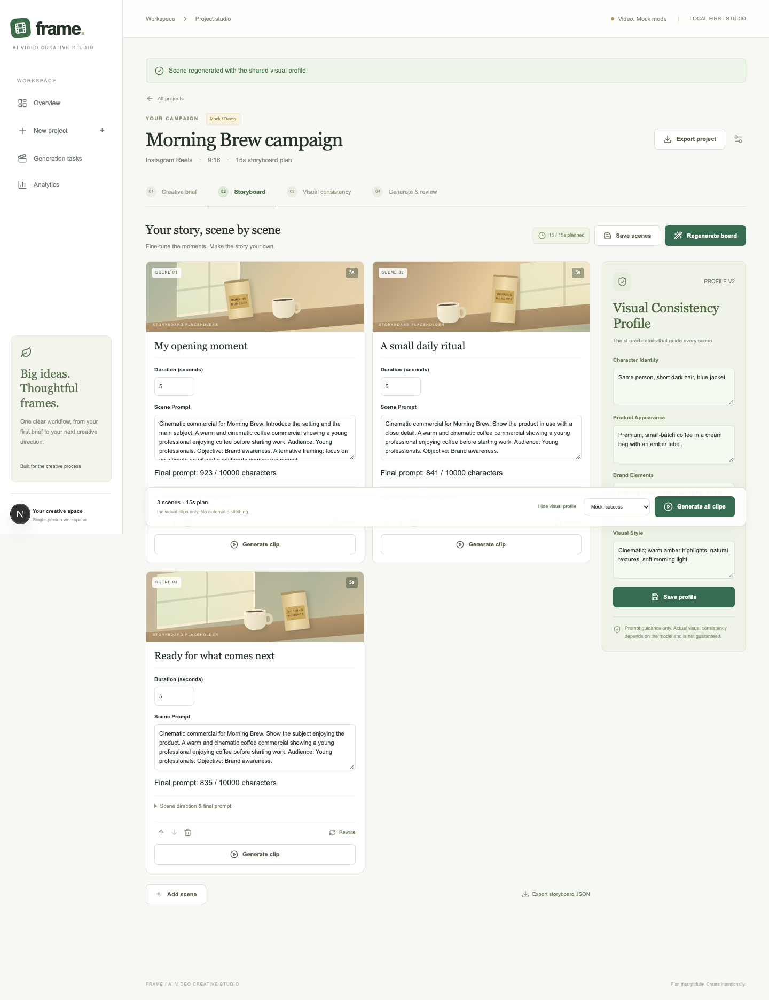

# AI Video Creative Studio · Frame

一个面向营销创作流程的完整本地 Web MVP：**Creative Brief → Storyboard → Visual Consistency Profile → Scene Editing → Video Tasks → Review → Analytics / JSON Export**。

英文 UI，中文产品与技术文档。无 API Key 即可运行。默认分镜是明确标注的模板 Mock，视频是带水印的固定演示素材；不把它们称作真实模型生成，不自动拼接成片。



截图来自自动化测试中的虚构品牌样例，不是外部用户数据或真实模型效果。

## 快速启动

要求 Node.js 22.20+、npm；macOS 或 Linux。SQLite 无需单独安装。FFmpeg 只在重新制作演示素材时需要，正常使用无需安装。

```bash
cd /Users/qiyongxi/lively/ai-video-creative-studio
cp .env.example .env
npm ci
npm run db:migrate
npm run dev
```

打开 [http://127.0.0.1:3000](http://127.0.0.1:3000)。已有 `.env` 时保留它，不要用示例覆盖真实配置。项目与任务保存在 `prisma/studio.db`，刷新或重启不会清空。

点击 **Try the coffee campaign → Generate storyboard**，编辑四项共享视觉说明并保存；修改 Scene 后点击 Save scenes，然后 Generate clip。约六秒后可预览演示视频并提交评分。Mock scenario 可选择失败，随后重试。15/30 秒是规划时长，默认 3/5 个镜头。

## 已实现与边界

- Brief 校验、示例与保存；分镜字段编辑、增删、排序、单镜头重写和 JSON 导出。
- 四字段 Visual Consistency Profile 自动引用，最终 Prompt 可检查，任务保留不可变输入快照。
- 异步状态、失败重试、刷新恢复、评分反馈、历史记录与完整项目导出。
- 三项主要指标及基础失败/重试/耗时；终态成功率、来源及模式分离。
- 百炼 Qwen + 万相 2.2/2.6 Adapter、OpenAI Structured Outputs Adapter、旧版 BACH v1 Adapter、服务端凭证与密码保护。
- 产品研究假设、决策、测试方案和英文案例。

**未验证：** 真实付费 API 调用、旧版 BACH 线上可用性、Docker 镜像运行及 Railway 上线、真实用户研究。没有真实用户增长或生成质量结论。实际运行过的检查以 [TEST_RESULTS.md](TEST_RESULTS.md) 为准。

## Live 配置

只编辑服务端 `.env` 或部署环境变量；不要把 Key 发到聊天、前端表单或 Git。更改配置后重启服务。

| 变量                              | 用途                                                                                   |
| --------------------------------- | -------------------------------------------------------------------------------------- |
| DATABASE_URL                      | 默认 `file:./studio.db`，相对路径以 prisma 目录为基准；生产建议 `file:/data/studio.db` |
| STORYBOARD_PROVIDER               | `mock`（默认）、`qwen` 或 `openai`                                                     |
| DASHSCOPE_API_KEY                 | 选择 `qwen` 时必填；阿里云百炼 API Key，仅保存在服务端                                 |
| DASHSCOPE_BASE_URL                | 选择 `qwen` 时必填；从控制台复制对应业务空间和地域的 `compatible-mode/v1` Base URL     |
| DASHSCOPE_MODEL                   | 默认 `qwen-flash`；需支持非思考模式 JSON Object 输出                                   |
| OPENAI_API_KEY / OPENAI_MODEL     | 仅选择 `openai` 时必填，模型需支持 Structured Outputs                                  |
| VIDEO_PROVIDER                    | `mock`（默认）、`wan2.2`（480P/5秒）、`wan2.6`（720P/2–15秒）或 `bach-v1`              |
| BACH_ACCESS_KEY / BACH_SECRET_KEY | 旧版 BACH 鉴权；仅服务端使用                                                           |
| APP_PASSWORD / SESSION_SECRET     | 私密演示密码 12+ 字符、签名密钥 32+ 字符                                               |

OpenAI 使用 Responses API，输出再次校验，错误不静默回退 Mock。[官方 Structured Outputs](https://developers.openai.com/api/docs/guides/structured-outputs)。

BACH 只实现历史 `bach-1.0` v1 Text-to-Video，单镜头 1–8 秒。当前旧页面已跳转到 Pro，新接口并非同一协议。当前[官方鉴权页](https://www.bach.art/api/docs/authentication)明确描述 AK/SK 签发 HS256 JWT；本项目没有根据 Key 名称推测鉴权。接入代码和模拟协议测试不等于确认旧接口仍可使用。缺少账号权限或旧版被关闭时继续使用 Mock，不自动改用 Pro。

### 无需美国银行卡的低成本接入

真实完整链路：百炼 Qwen 分镜 + 万相生成实际镜头 + 播放和 Review。Mock 视频只是仓库自带演示 MP4，不根据 Prompt 生成内容。阿里云国内站支持支付宝、银联及网银充值，无需 OpenAI 账号。[官方充值说明](https://help.aliyun.com/zh/document_detail/324650.html)

1. 在[阿里云百炼](https://www.aliyun.com/product/bailian)开通北京地域模型服务，在默认业务空间创建可调用 Qwen 和万相的 API Key。一个 Key 用于两个 Adapter，调用及计费均在阿里云。
2. 只修改项目根目录已有 `.env` 中的以下变量，保留 `DATABASE_URL` 等其他配置。下方为北京地域公共 Base URL，也可以使用控制台给出的对应专属域名；Key、地域及业务空间须一致。[官方调用步骤](https://help.aliyun.com/en/model-studio/first-api-call-to-qwen)

   ```dotenv
   STORYBOARD_PROVIDER="qwen"
   DASHSCOPE_API_KEY="替换为你的百炼APIKey"
   DASHSCOPE_BASE_URL="https://dashscope.aliyuncs.com/compatible-mode/v1"
   DASHSCOPE_MODEL="qwen-flash"
   VIDEO_PROVIDER="wan2.2"
   ```

3. 停止原开发服务，执行 `npm run dev`，打开 `http://127.0.0.1:3000`。缺少配置时页面显示 API setup required 并禁用生成；Live 标签只表示真实 Provider 被选中，不代表已成功连接。
4. 创建 15 秒示例，Generate storyboard 得到三个 5 秒镜头，再点第一个 Generate clip，等待真实万相任务完成、播放新视频并保存 Review。第一次先生成一个镜头，确认成功后再生成其他镜头。优先检查免费额度，再按需小额充值。

2026-10-17 核对的北京地域 `qwen-flash` 短上下文价格：输入 0.15 元/百万 Token、输出 1.5 元/百万 Token。假设单次输入 2,000、输出 3,000 Token，则约 0.0048 元/次，100 次约 0.48 元；这是按公开单价计算的估算，不是实测用量，不含重试。不同模型、地域及未来价格可能不同。[官方价格](https://help.aliyun.com/zh/model-studio/model-pricing)

Qwen Flash 使用非思考模式 JSON Object，再由服务端校验 Schema、镜头数量和时长；JSON Object 本身不保证字段结构。请求上限为 8,192 个输出 Token；Base URL 仅接受官方 HTTPS 地址，不跟随重定向。[官方结构化输出说明](https://help.aliyun.com/en/model-studio/qwen-structured-output)

万相 2.2 已实现：480P、固定 5 秒、无声，约 0.70 元/镜头，三个镜头约 2.10 元；万相 2.6 已实现：720P、2–15 秒整数，北京参考价 0.60 元/秒。30 秒默认五个 6 秒镜头需要显式选择 `wan2.6`，或手动编辑为六个 5 秒镜头后使用 `wan2.2`。不静默改时长或切换收费模型。

完整配置、成本、首次真实验收和错误排查见 [REAL_API_SETUP.md](REAL_API_SETUP.md)。万相结果链接 24 小时有效，本版不永久存储媒体，需从 Open clip 保存。当前协议和持久化链路测试使用模拟响应，真实付费验收仍需自己的 Key 和实际生成结果。

## 验证命令

```bash
npm run typecheck
npm test
npm run lint
npm run build
npm run test:e2e
npm run test:production
```

E2E 在 3100 端口启动独立服务、使用 `prisma/e2e.db`，不会写入日常数据库。macOS 若已有 Google Chrome 则使用它；其他环境先执行 `npx playwright install chromium`。生产冒烟测试需要先构建，在 3200 端口用仅保存在内存的临时密码和独立临时数据库验证保护逻辑及服务重启恢复。合成凭证与模拟响应均不是真实 API 调用。

## 本地生产运行

先通过环境变量提供 APP_PASSWORD 和 SESSION_SECRET，再执行 `npm run build`、`npm run start`。生产 Cookie 为 Secure，浏览器正式使用应通过 HTTPS 反向代理；普通本地体验使用 `npm run dev`。NODE_ENV=production 时缺少密码配置会拒绝访问，不会开放工作台。

## Docker 与 Railway 部署步骤

配置已提供，尚未声称完成实际部署。

1. 将源码放入自己的 GitHub 仓库；不要上传 `.env`、数据库或测试输出。
2. Railway 新建服务，选择该仓库及本项目根目录，使用 Dockerfile，保持单实例。
3. 增加持久卷挂载 `/data`，设置 `DATABASE_URL=file:/data/studio.db`，提供 APP_PASSWORD、SESSION_SECRET；先保持双 Mock。
4. 镜像启动时在挂载后的文件系统执行迁移，不在没有持久卷的预部署阶段迁移。设置健康检查 `/api/health`。
5. 部署成功后开启 HTTPS 地址，验证未登录跳转、登录、创建项目、重启恢复，再在平台 Secrets 配置 Live Key（如需要）。
6. 使用平台持久卷备份，升级前备份数据库；不配置副本共享同一 SQLite 文件。[Railway 持久卷说明](https://docs.railway.com/volumes/reference)

本地可构建镜像（需要运行中的 Docker）：

```bash
docker build -t frame-studio .
docker run --rm -p 3000:3000 -v frame-data:/data --env-file .env.production frame-studio
```

注意：另建被 Git 忽略的 `.env.production`，设置上述密码、签名密钥和生产数据库路径；示例 `.env` 默认密码为空。通过 HTTPS 代理访问容器。实际付费部署需自己的账号和计费授权，本项目未创建任何云资源。

生产构建使用 Next.js 支持的 `--webpack`。本机 Turbopack 构建遇到内部端口限制，Webpack 构建已实际通过。

## 文档与作品集

- [产品需求与轻量竞品研究](PRODUCT_REQUIREMENTS.md)
- [产品决策与取舍](PRODUCT_DECISIONS.md)
- [技术架构、API 与指标定义](ARCHITECTURE.md)
- [用户测试方案与空白记录模板](USER_TESTING.md)
- [英文 Portfolio Case Study 与 CV 描述](PORTFOLIO_CASE_STUDY.md)
- [三分钟 Demo 指南](DEMO_GUIDE.md)
- [实际测试记录](TEST_RESULTS.md)

核心技术亮点：版本检查、服务端 Schema 校验、输入快照、Provider 能力检查、数据库恢复和幂等事件。产品亮点：从营销任务出发、共享视觉说明、可追溯尝试和不混淆 Mock 的指标。它们是已实现的流程能力，不等于已验证的商业效果。

## 代码结构

`src/app` 为页面和 REST 接口；`src/components` 为英文工作台；`src/lib` 为 Schema、业务服务、权限、指标及 Provider；`prisma` 为 Schema 与迁移；`tests` 为业务、协议和浏览器测试；`public/mock` 为原创带水印的演示视频。
